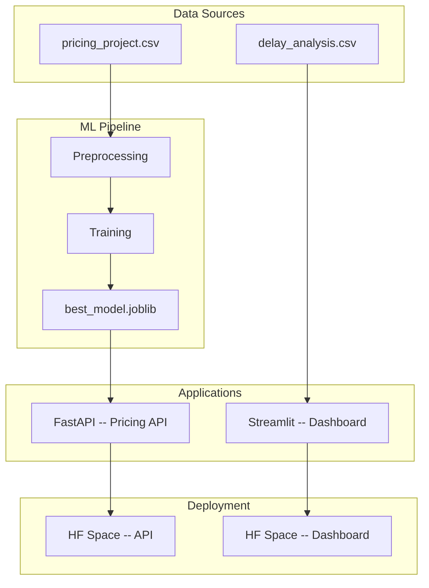
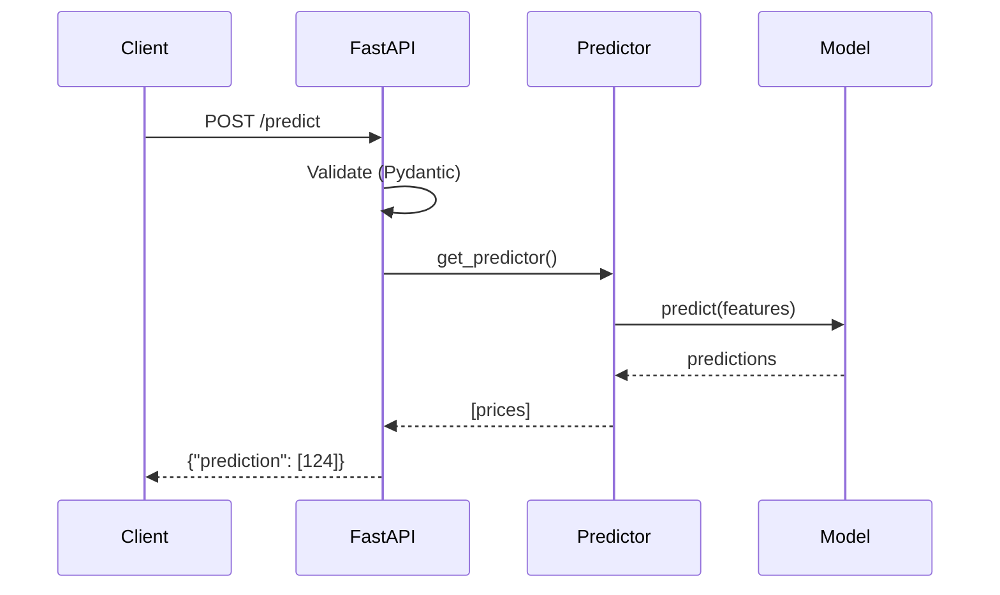
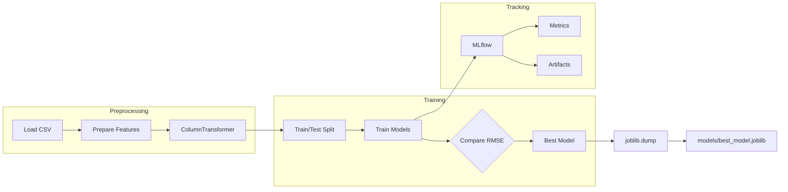
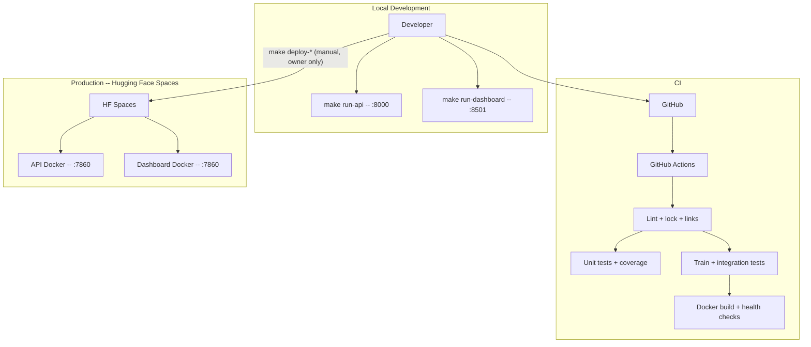
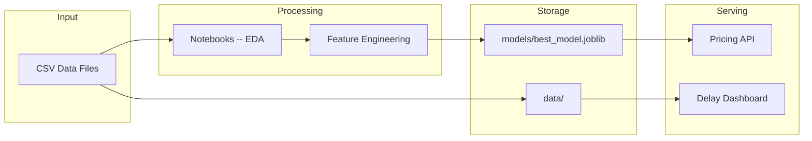

# Architecture

## System Overview



## API Flow



## ML Pipeline



Three models are compared: LinearRegression, RandomForestRegressor, GradientBoostingRegressor. The best model (lowest RMSE) is serialized as a scikit-learn Pipeline (preprocessor + model) using joblib.

## Project Structure

```
getarround/
    .github/workflows/ci.yml    # GitHub Actions: lint, unit tests, integration, Docker
    data/
        get_around_delay_analysis.xlsx  # source file, read by notebook 01
        get_around_delay_analysis.csv   # written by notebook 01, read by the dashboard
        get_around_pricing_project.csv
    deploy/
        DEPLOYMENT.md
        hf-api/                   # Space files, copied by `make stage-api`
            Dockerfile
            README.md
            .dockerignore
            .gitattributes
            .gitignore
            pyproject.toml        # API dependency list
            uv.lock
        hf-dashboard/             # Space files, copied by `make stage-dashboard`
            Dockerfile
            README.md
            .dockerignore
            .gitattributes
            .gitignore
            pyproject.toml        # dashboard dependency list
            uv.lock
    docs/
        ARCHITECTURE.md           # this file
    models/                       # gitignored, generated by `make train`
        best_model.joblib
    mlruns/                       # gitignored, MLflow tracking data
    notebooks/
        00_assignment.ipynb
        01_delay_analysis_eda.ipynb   # delay analysis EDA, writes the delay CSV
        02_pricing_ml_eda.ipynb       # pricing features and model selection
    scripts/
        check_readme_links.py     # checks the repository paths cited in Markdown
    src/
        __init__.py
        api/
            __init__.py
            main.py               # FastAPI app with lifespan, CORS, /health
            routers/
                __init__.py
                predict.py        # POST /predict endpoint
            schemas/
                __init__.py
                prediction.py     # Pydantic request/response models
        config/
            __init__.py
            settings.py           # Pydantic Settings, env-based config, logging
        dashboard/
            __init__.py
            app.py                # Streamlit entry point: sidebar, six sections
            data.py               # data loading, derived datasets, rates with bases
            simulation.py         # threshold simulation
            sections/             # one module per dashboard section (1 to 6)
        ml/
            __init__.py
            predict.py            # PricingPredictor singleton, joblib loading
            preprocessing.py      # Feature definitions, ColumnTransformer
            train.py              # MLflow experiment, model comparison
    tests/
        __init__.py
        conftest.py               # shared fixtures (API client with a mock model)
        factories.py              # Factory Boy: CarFeatures, LuxuryCar, BudgetCar
        unit/
            __init__.py
            test_api.py
            test_dashboard_app.py # renders the dashboard with Streamlit AppTest
            test_ml.py
            test_simulation.py    # threshold simulation and rates
        integration/
            __init__.py
            test_api_integration.py   # needs models/best_model.joblib
    .env.example
    .gitignore
    .pre-commit-config.yaml
    .python-version               # 3.11
    LICENSE                       # MIT
    Makefile
    pyproject.toml
    uv.lock
```

## Dependencies

The root `pyproject.toml` (package name: `getaround`) defines the development
environment: both applications, training, tests and notebooks. It is not
deployed.

Each demo has its own dependency list in `deploy/hf-api/` and
`deploy/hf-dashboard/` (`pyproject.toml` and `uv.lock`). These lists are copies
of the files of the live Spaces, so that `make deploy-*` reproduces them. The
API runtime dependencies have no Streamlit or Plotly; the dashboard runtime
dependencies have no FastAPI or scikit-learn.

### Root: runtime

| Package | Version | Purpose |
|---------|---------|---------|
| fastapi | ~0.115.0 | REST API framework |
| uvicorn[standard] | ~0.30.0 | ASGI server |
| streamlit | ~1.40.0 | Dashboard framework |
| scikit-learn | ~1.5.0 | ML models and preprocessing |
| pandas | ~2.2.0 | Data manipulation |
| pydantic | ~2.10.0 | Request/response validation |
| pydantic-settings | ~2.10.0 | Environment-based configuration |
| numpy | ~1.26.0 | Numerical computation |
| plotly | ~5.24.0 | Interactive charts |
| httpx | ~0.27.0 | HTTP client (dashboard calls API) |
| joblib | >=1.0 | Model serialization |

### Root: dev group (installed by `uv sync`)

| Package | Purpose |
|---------|---------|
| ruff ==0.15.0 | Linting and formatting |
| pytest, pytest-cov | Testing |
| pre-commit | Git hooks |
| factory-boy | Test data generation |
| mlflow ~2.19.0 | Experiment tracking (training only) |

### Root: notebooks group (installed by `make install-dev`)

| Package | Purpose |
|---------|---------|
| jupyter, ipykernel | Notebooks |
| openpyxl | Reads the xlsx source file in notebook 01 |

## Configuration

Environment-based via `pydantic-settings`. Settings loaded from `.env` file and environment variables (env vars take precedence).

Key settings: `ENVIRONMENT` (development/testing/production), `LOG_LEVEL`, `API_URL`, `API_HOST`, `API_PORT`, `DASHBOARD_PORT`, `MLFLOW_TRACKING_URI`, `DATA_DIR`, `MODELS_DIR`.

Logging is configured per environment (DEBUG for dev, WARNING for test, INFO for production).

## Deployment Architecture



### Assemble-on-deploy strategy

Deploy directories (`deploy/hf-api/`, `deploy/hf-dashboard/`) contain the files of each Space: `Dockerfile`, `README.md`, `.dockerignore`, `.gitignore`, `.gitattributes`, and the per-demo dependency list (`pyproject.toml`, `uv.lock`). They do not duplicate source code, models or data.

Deploys are manual, and only the owner runs them. First, a stage target assembles the files of one Space in a gitignored directory and uploads nothing:

- **`make stage-api`** fills `.tmp/hf-api/` with the files of `deploy/hf-api/`, `LICENSE`, `src/__init__.py`, `src/api/`, `src/ml/` (`__init__.py`, `predict.py`, `preprocessing.py`), `src/config/`, and `models/best_model.joblib`.
- **`make stage-dashboard`** fills `.tmp/hf-dashboard/` with the files of `deploy/hf-dashboard/`, `LICENSE`, `src/__init__.py`, `src/dashboard/` (with `sections/`), `src/config/`, and `data/*.csv`.

Then `make deploy-api` or `make deploy-dashboard` uploads the staged tree with `hf upload` (huggingface_hub 1.x, run through `uvx`), without deleting files in the Space. The Dockerfiles `COPY` the same source modules, and use a multi-stage build: the builder stage installs the per-demo dependency list, and the production stage runs as non-root user uid 1000.

The deployment repositories `tryph0n/getaround_api` and `tryph0n/getaround_dashboard` are copies of the staged trees, updated by hand.

### HF Spaces URLs

| Space | URL |
|-------|-----|
| API | `https://sam-bot-get-around-api.hf.space` |
| Dashboard | `https://sam-bot-get-around-dashboard.hf.space` |

## Makefile Targets

| Target | Description |
|--------|-------------|
| `make install-prod` | Install production dependencies (`uv sync --no-group dev`) |
| `make install-dev` | Install all dependencies (dev and notebooks groups) |
| `make lint` | Run ruff check on the repository |
| `make format` | Run ruff format + fix on the repository |
| `make test` | Run pytest |
| `make train` | Train models with MLflow tracking, saves `models/best_model.joblib` |
| `make run-api` | Start FastAPI on :8000 with reload |
| `make run-dashboard` | Start Streamlit on :8501 |
| `make stage-api` | Build the API staging tree in `.tmp/hf-api/` (no upload) |
| `make stage-dashboard` | Build the dashboard staging tree in `.tmp/hf-dashboard/` (no upload) |
| `make deploy-api` | Stage, then upload the API to HF Spaces, owner only (see `deploy/DEPLOYMENT.md`) |
| `make deploy-dashboard` | Stage, then upload the dashboard to HF Spaces, owner only (see `deploy/DEPLOYMENT.md`) |
| `make deploy-all` | Deploy both |
| `make clean` | Remove __pycache__, .pyc, .pytest_cache, .ruff_cache |

## CI Pipeline

GitHub Actions (`.github/workflows/ci.yml`) runs on push and pull request to main, and on manual dispatch. Each job that runs Python sets up uv, which takes Python 3.11 from `.python-version`, and runs `uv sync --locked`.

1. **lint**: `ruff check`, `ruff format --check`, `uv lock --check` for the root and both `deploy/hf-*` lists, and the link checker on `README.md`, `docs/` and `deploy/DEPLOYMENT.md`.
2. **test** (needs lint): unit tests with coverage (`uv run pytest tests/unit --cov=src --cov-report=term-missing`, threshold in `pyproject.toml`).
3. **integration** (needs lint): `make train`, then the integration tests; the job fails if a test is skipped. The trained model is kept as the `model` artifact.
4. **docker** (needs integration): downloads the `model` artifact, runs `make stage-api stage-dashboard`, builds both images, starts them, and waits for `/health` to report `"model_loaded":true` and for `/_stcore/health` to return `ok`. CI never uploads to HF Spaces.

## Data Flow



## Gitignored Artifacts

| Path | Content |
|------|---------|
| `models/` | Trained model (generated by `make train`) |
| `mlruns/` | MLflow experiment tracking data |
| `.tmp/` | Temporary deploy assembly directory |
| `.venv/` | Python virtual environment |
| `.env` | Environment variables (`.env.example` tracked) |
| `.doc/` | Project documentation (not shipped) |
